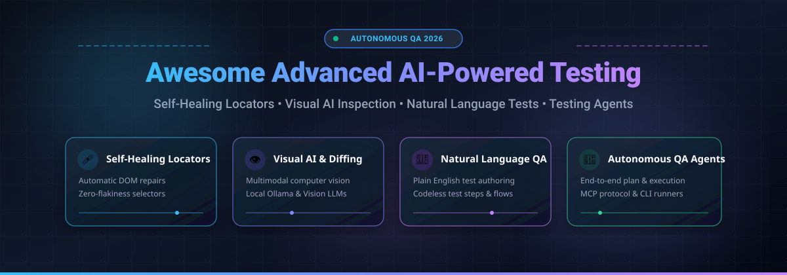

# 🧪 Awesome Advanced AI-Powered Testing Features

  

  
  
  
  
  
  

---

> **A curated discovery list of top SaaS platforms and open-source GitHub projects advancing AI in Software Quality Assurance (QA).**  
> Explore next-generation test automation capabilities: **Self-Healing Locators**, **Visual AI Testing & Diffing**, **Natural Language Test Authoring**, and **Autonomous Testing Agents**.

**Last updated:** November 2026 📅

---

## 📑 Table of Contents

- [🌐 Sector Overview & Market Dynamics](#-sector-overview--market-dynamics)
- [☁️ SaaS & Hosted AI Testing Platforms](#️-saas--hosted-ai-testing-platforms)
- [💻 Open-Source GitHub Projects](#-open-source-github-projects)
- [🧩 Capabilities Matrix & Guide](#-capabilities-matrix--guide)
- [🤝 How to Contribute](#-how-to-contribute)
- [💖 Support & Sponsor](#-support--sponsor)
- [⚠️ Disclaimer](#️-disclaimer)
- [📈 Star History](#-star-history)

---

## 🌐 Sector Overview & Market Dynamics

The global **AI in Software Testing market** is valued between **$1.5 billion and $3.5 billion**, rapidly expanding at a CAGR of roughly **18% to 20%** as enterprise CI/CD release cycles demand autonomous verification. The sector remains **moderately fragmented**—distinguished by well-capitalized test-cloud leaders (Tricentis, BrowserStack, Perforce) executing strategic acquisitions alongside a vibrant ecosystem of specialized AI point solutions and agile open-source projects innovating across vision models, local LLM triage, and self-healing algorithms.

---

## ☁️ SaaS & Hosted AI Testing Platforms

The following SaaS solutions offer enterprise-grade cloud test infrastructure, AI test generation, visual AI diffing, and auto-healing capabilities. Ranked by company scale (valuation / annual revenue in descending order):

| Company & Platform 🏢 | Valuation / Revenue Scale 📊 | Starting Tier Pricing 💵 | Free Tier / Trial Limit 🎁 | Core AI Testing Features 🧠 | Best For 🎯 |
| :--- | :--- | :--- | :--- | :--- | :--- |
| **[Tricentis Tosca](https://www.tricentis.com/products/tosca)** | ~$4.5B valuation / ~$500M ARR | ~$1,667/month ($20,000/year minimum contract) | 14-day free trial (request-only; full core platform access) | Model-based automation, Vision AI image-based locator healing, and risk-based test optimization | Large enterprises with complex packaged ERP/SAP workflows needing governance |
| **[BrowserStack AI](https://www.browserstack.com/)** | ~$4.0B valuation / ~$230M ARR | $99/month (Automate plan with AI agents) | Percy Free forever plan (5,000 screenshots/month); Automate offers 14-day trial (limited to 100 minutes) | Automate Agent for plain English test authoring, Visual Review Agent, and Test Selection Agent | Cross-browser & real device testing teams seeking bundled AI authoring and triage |
| **[Testim (Tricentis)](https://www.testim.io/)** | Tricentis subsidiary (~$4.5B parent) / ~$30M+ ARR | $1,000/month ($12,000/year annual contract) | 14-day free trial (full platform features up to 1,000 test runs) | Fast low-code test authoring powered by AI-driven dual-engine self-healing locators | Agile web teams wanting codeless authoring without broken selector maintenance |
| **[Perfecto (Perforce)](https://www.perfecto.io/)** | Perforce subsidiary (~$1.07B EV) / ~$20M+ ARR | $99/month (Essential Web & Mobile tier) | 14-day free trial (access to real cloud devices, 120 testing minutes limit) | Smart failure analysis, AI-driven digital assistant for root-cause classification | High-velocity mobile app teams requiring real-device cloud grids |
| **[LambdaTest KaneAI](https://www.lambdatest.com/kane-ai)** | ~$400M valuation / ~$50M+ ARR | $17/month billed annually (KaneAI Starter; 2,000 test credits) | 14-day free trial (TestMu platform free tier with 60 live test mins/month; Kane CLI free locally) | Conversational AI agent (KaneAI) that writes, debugs, and evolves E2E tests from text | Teams leveraging multi-platform cross-browser clouds with natural language test authoring |
| **[mabl](https://www.mabl.com/)** | ~$400M valuation / ~$30M ARR | $450/month tier-based (500 cloud test credits/mo minimum) | 14-day free trial (unlimited local runs and 200 cloud test credits) | Low-code intelligent test automation with autonomous DOM auto-healing and performance triage | Continuous delivery teams covering web, API, and accessibility under one roof |
| **[Applitools Eyes](https://www.applitools.com/)** | ~$350M–$500M valuation / ~$40M ARR | $99/month (Starter tier checkpoint-based) | 14-day free trial (includes 5,000 visual checkpoints/month for testing) | Industry-standard Visual AI with computer-vision-based layout matching and regression diffing | Teams where pixel-perfect visual precision across resolutions is top priority |
| **[Katalon Studio](https://katalon.com/)** | Private (~$36M–$60M ARR) | $59/seat/month (True Platform; Studio Enterprise from $229/seat/month) | Free Desktop Edition (Katalon Studio Free, forever limited to local script execution) | AI-powered self-healing smart locators, automated failure triaging, and MCP integration | Mixed engineering teams needing flexibility between codeless IDE and scripted tests |
| **[Functionize](https://www.functionize.com/)** | ~$67M+ funding / ~$25M ARR | $20/month (Individual tier; Team tier from $40/month) | 14-day free trial (includes access to Architect recorder and 100 cloud executions) | Natural language Architect recorder, self-healing Smart XPaths, and autonomous visual analysis | Small-to-medium teams looking for cost-effective AI test creation without complex infra |
| **[testRigor](https://testrigor.com/)** | Seed-stage (~$5.1M funding) / ~$15M ARR | $900/month (entry parallelization plan; standard from $1,800/month) | Free Public Forever plan (all test cases and results remain publicly accessible); 14-day private trial | Plain English test creation requiring zero technical code, unlimited seats, and parallel agent scaling | Non-technical manual testers, PMs, and QA leads authoring test suites in plain English |

---

## 💻 Open-Source GitHub Projects

Explore the leading open-source repositories powering autonomous testing, visual regression with local models, and self-healing Playwright/Selenium frameworks. Sorted by GitHub stars in descending order:

1. ### 🌟 [Midscene.js](https://github.com/web-infra-dev/midscene) 
   - **Repository:** `web-infra-dev/midscene`
   - **Focus:** *Multimodal AI-driven UI Automation & E2E Testing Framework*
   - **Highlights:** Utilizes multimodal vision models (GPT-4o, Claude, Qwen-VL, UI-TARS) to perceive the screen via screenshots instead of fragile CSS/XPath selectors. Offers `aiAct`, `aiAssert`, `aiWaitFor`, and `aiQuery`. Operates with Playwright, Puppeteer, or standalone YAML test scripts with visual reasoning logs.
   - **Tech Stack:** TypeScript, Node.js, Multimodal Vision Models

2. ### 🌟 [LaVague](https://github.com/lavague-ai/LaVague) 
   - **Repository:** `lavague-ai/LaVague`
   - **Focus:** *Large Action Model (LAM) Framework for Autonomous Web Navigation & Testing*
   - **Highlights:** Open-source agent engine converting natural language instructions into concrete browser actions and Playwright/Selenium test code. Features world-model perception and automated agentic test generation.
   - **Tech Stack:** Python, Playwright, Selenium, Local/Cloud LLMs

3. ### 🌟 [Selenium IDE (SIDE Runner)](https://github.com/SeleniumHQ/selenium-ide) 
   - **Repository:** `SeleniumHQ/selenium-ide`
   - **Focus:** *Open-Source Record & Playback with Built-in Fallback Locator Healing*
   - **Highlights:** Official record and playback tool featuring multi-locator recording strategies. Automatically records an element's ID, CSS, XPath, and text coordinates, falling back dynamically during playback if the primary locator fails.
   - **Tech Stack:** JavaScript, WebExtensions, Selenium

4. ### 🌟 [reg-suit](https://github.com/reg-viz/reg-suit) 
   - **Repository:** `reg-viz/reg-suit`
   - **Focus:** *Visual Regression Testing CLI with CI/CD Snapshot Diffing*
   - **Highlights:** Automated visual diff tool comparing image snapshots on every Git commit. Integrates with AWS S3, Google Cloud Storage, and GitHub PR comments for continuous visual review without third-party SaaS subscriptions.
   - **Tech Stack:** TypeScript, Node.js, GitHub Actions

5. ### 🌟 [agent-qa](https://vostride.com) 
   - **Repository:** [`vostride/agent-qa`](https://github.com/vostride/agent-qa)
   - **Focus:** *Self-Hosted Natural-Language Web & Mobile QA*
   - **Highlights:** Open source (FSL-1.1-ALv2) QA for web, Android and iOS through a CLI, dashboard or MCP. **memidex** retains reviewable facts and working procedures; self-improvement validates and updates that knowledge from runs and feedback, with digests, steps and screenshots for inspection.
   - **Tech Stack:** TypeScript, Node.js 24+, MCP

6. ### 🌟 [Visual Regression Tracker](https://github.com/Visual-Regression-Tracker/Visual-Regression-Tracker) 
   - **Repository:** `Visual-Regression-Tracker/Visual-Regression-Tracker`
   - **Focus:** *Self-Hosted Visual Testing Platform & Image Comparison Backend*
   - **Highlights:** Open-source alternative to Applitools and Percy for visual regression testing. Provides unified REST API, baseline management, branch tracking, and client SDKs for Cypress, Playwright, Puppeteer, Selenium, and WebdriverIO.
   - **Tech Stack:** TypeScript, NestJS, React, PostgreSQL

7. ### 🌟 [Appraise](https://github.com/AppraiseQA/appraise) 
   - **Repository:** `AppraiseQA/appraise`
   - **Focus:** *Markdown-Driven Visual Approval & Visual Regression Testing*
   - **Highlights:** Specification-by-example visual testing framework. Write markdown documentation that executes via headless browsers, capturing and validating screenshot states as living documentation.
   - **Tech Stack:** JavaScript, Puppeteer, Markdown

8. ### 🌟 [Happo.io CLI](https://github.com/happo/happo.io) 
   - **Repository:** `happo/happo.io`
   - **Focus:** *Cross-Browser Screenshot Diffing for Component Libraries*
   - **Highlights:** Open-source test runner and diffing tooling for Storybook, React, and UI component libraries across responsive screen viewports.
   - **Tech Stack:** JavaScript, Storybook, Cypress

9. ### 🌟 [noqa](https://github.com/noqa-ai/noqa) 
   - **Repository:** `noqa-ai/noqa`
   - **Focus:** *Vision-Based Mobile App & Game Testing Agent*
   - **Highlights:** Zero locators, zero code, and zero SDK requirements. Interacts with iOS, Android, Flutter, React Native, Unity, and Unreal game screens purely through visual grounding, screenshot inspection, and natural language prompts.
   - **Tech Stack:** Python, CLI, Multimodal Vision

10. ### 🌟 [Healenium](https://github.com/healenium/healenium) 
    - **Repository:** `healenium/healenium`
    - **Focus:** *Machine-Learning Self-Healing Proxy for Selenium & Appium*
    - **Highlights:** Proxies automation requests and intercepts locator failure exceptions (`NoSuchElementException`). Uses ML algorithms and DOM mutation distance trees to heal broken selectors at runtime and persist fixes to PostgreSQL.
    - **Tech Stack:** Java, Docker, PostgreSQL, Selenium, Appium

11. ### 🌟 [Syngrisi](https://github.com/syngrisi/syngrisi) 
    - **Repository:** `syngrisi/syngrisi`
    - **Focus:** *Self-Hosted Visual AI Testing Platform with Local Ollama Triage*
    - **Highlights:** 100% private, self-hosted visual testing with local vision models (Qwen-VL, Gemma via bundled Ollama). Features AI Match across resolutions, DOM root cause analysis, MCP server support, and automated triage classifications (`intended change`, `likely bug`, `noise`).
    - **Tech Stack:** Node.js, Express, MongoDB, React, Mantine, Ollama

12. ### 🌟 [Healwright](https://github.com/amrsa1/healwright) 
    - **Repository:** `amrsa1/healwright`
    - **Focus:** *Playwright Self-Healing Selector Engine with FastMCP Server*
    - **Highlights:** Automatically detects broken locators during Playwright test runs. Computes similarity heuristic scores across IDs, classes, attributes, and text. Integrates directly into IDE coding agents via FastMCP server with headless verification.
    - **Tech Stack:** Python, Playwright, FastMCP

13. ### 🌟 [Yewo](https://github.com/yewohq/yewo) 
    - **Repository:** `yewohq/yewo`
    - **Focus:** *Autonomous AI E2E Mobile Testing Agent*
    - **Highlights:** Describe user journeys in plain English; Yewo interprets the mobile screen, plans actions, and drives Android and iOS devices without requiring test IDs or source instrumentation. Features automatic secret masking and audit logs.
    - **Tech Stack:** Python, Appium, LiteLLM

14. ### 🌟 [playwright-self-healing-framework](https://github.com/ShantanuVr/playwright-self-healing-framework) 
    - **Repository:** `ShantanuVr/playwright-self-healing-framework`
    - **Focus:** *Deterministic Zero-LLM Self-Healing Framework for Playwright*
    - **Highlights:** Generates semantic element fingerprints on first contact using 6 weighted sub-scores (text, anchor context, tags, attributes, classes, ID). Recovers broken locators deterministically without external LLM API costs.
    - **Tech Stack:** TypeScript, Playwright, Vitest

15. ### 🌟 [CANVAS (canvas-heal)](https://github.com/mandavillivijay/CANVAS) 
    - **Repository:** `mandavillivijay/CANVAS`
    - **Focus:** *Semantic Intent-Based Self-Healing for Pytest & Selenium/Playwright*
    - **Highlights:** Captures semantic descriptors (roles, intents, context) and resolves changed selectors via confidence-gated thresholds (auto-heals above 0.92; requires confirmation between 0.75 and 0.92).
    - **Tech Stack:** Python, Pytest, Sentence-Transformers, SQLite

---

## 🧩 Capabilities Matrix & Guide

Choosing the right testing paradigm is essential for building stable automation suites:

* **Visual AI & Diffing:**  
  * **SaaS:** Applitools Eyes, BrowserStack Percy  
  * **Open-Source:** Syngrisi, Visual Regression Tracker, reg-suit, Midscene.js  
  * *When to choose:* When UI layout fidelity, cross-browser rendering shifts, and pixel-level consistency must be validated across hundreds of viewports.
* **Self-Healing Locators:**  
  * **SaaS:** Testim (Tricentis), mabl, Katalon  
  * **Open-Source:** Healenium, Healwright, playwright-self-healing-framework, CANVAS  
  * *When to choose:* When dynamic front-end frameworks (React, Angular, Vue) cause brittle XPath/CSS selector flakiness and high maintenance costs.
* **Natural Language Test Authoring:**  
  * **SaaS:** testRigor, Functionize, LambdaTest KaneAI  
  * **Open-Source:** Midscene.js, LaVague, Yewo  
  * *When to choose:* When product managers, domain experts, and manual QA specialists need to author or review executable automation in plain English.
* **Autonomous Vision-Based Mobile/Game Testing:**  
  * **SaaS:** Perfecto Mobile  
  * **Open-Source:** noqa, Yewo  
  * *When to choose:* When testing non-native UI canvas elements, WebViews, Flutter, Unreal, or Unity game engines where traditional element trees are unavailable.

---

## 🤝 How to Contribute

Contributions, tool suggestions, and documentation refinements are warmly welcome!

1. 🍴 **Fork** the repository.
2. 🌿 Create your feature branch (`git checkout -b feature/add-new-tool`).
3. 📝 Add your tool with factual descriptions, active GitHub links, and license information.
4. 🚀 Push to the branch (`git push origin feature/add-new-tool`).
5. 📬 Open a **Pull Request** and describe the addition.

---

## 💖 Support & Sponsor

Thank you for visiting and exploring **Awesome Advanced AI-Powered Testing Features**! 🎉

If you find this curated list helpful for your QA workflows, testing architecture, or engineering research, please consider supporting the project:

- 🌟 **Star** the repository to show your appreciation and boost its visibility!
- 🍴 **Fork** and contribute tools, updates, or benchmarks.
- 📢 **Share** this list with your engineering team, SDETs, and developer communities.
- ☕ **Buy me a coffee / Sponsor:** If you'd like to back ongoing maintenance and updates, you can support directly through the [GitHub Sponsors Dashboard](https://github.com/sponsors/ishandutta2007).

  

---

## ⚠️ Disclaimer

- This repository is a community-maintained curated index provided for educational and architectural reference.
- AI test tools that process screen captures, DOM models, or test data must be evaluated for compliance with relevant privacy regulations (such as GDPR, CCPA, and SOC 2).
- Check with your security and legal teams before feeding sensitive internal staging data or customer PII into public LLM endpoints.

---

## 📈 Star History

---

  Built with ❤️ for test automation leads, SDETs, and QA engineers innovating with autonomous AI.

